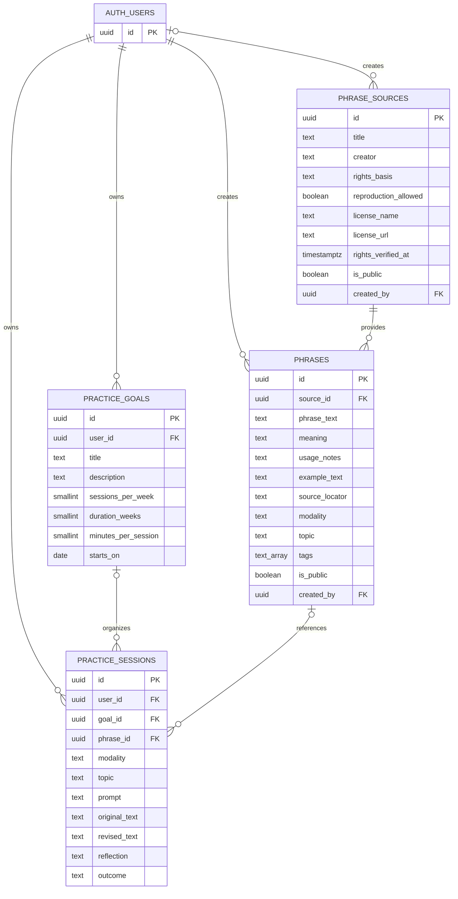

# Phrasecraft

Phrasecraft is a six-week writing and spoken-expression practice app. Study
communication phrases, express an idea in your own words, and reflect on what
made the result clearer or more natural.

The app supports email magic-link sign-in and Supabase storage for signed-in
practice. Signed-out practice is stored in the current browser. Existing local
practice is not automatically uploaded when you sign in. Spoken practice is
self-rehearsed; the app does not record or transcribe audio.

## Requirements

- Node.js 24
- pnpm 9
- A Supabase project for sign-in, shared phrases, and cloud practice history

## Run locally

```sh
pnpm install
```

Copy `.env.example` to `.env.local` and set your Supabase project URL and
publishable key. PowerShell users can run:

```powershell
Copy-Item .env.example .env.local
```

Then start the development server:

```sh
pnpm dev
```

Open the URL printed by Next.js. To create a production build, run `pnpm build`.

## Supabase setup

1. In the Supabase SQL Editor, run
   `supabase/migrations/20261105180000_phrasecraft_schema.sql`.
2. Then run
   `supabase/migrations/20261105210000_seed_elegant_communication_phrases.sql`
   to add the public 160-phrase collection. The seed includes compatibility
   changes for the additional source-provenance columns.
3. In Supabase Authentication settings, enable the Email provider and allow
   your local development URL (usually `http://localhost:3000`) as a redirect.
4. Configure `NEXT_PUBLIC_SUPABASE_URL` and
   `NEXT_PUBLIC_SUPABASE_PUBLISHABLE_KEY` in `.env.local`, then restart Next.js.

The publishable key is intended for browser use. Row-level security must remain
enabled. Never place a service-role/secret key or database password in a
`NEXT_PUBLIC_` variable.

## Code organization

The App Router entry points stay in `app/`. Interactive writing practice and its
browser-storage/domain logic live together in `features/practice/`; shared
Supabase client configuration and database types live in `lib/`.

## Database

The local Supabase migration is in `supabase/migrations/`. It defines phrase
sources and entries, SMART goals, and written/spoken practice sessions with
row-level security. Phrase text can only be associated with sources marked as
public domain, determined not copyrightable, licensed, permission-granted, or
user-authored. Use `reference_only` for bibliographic citations without copying
source content. Non-profit status alone does not make copyrighted text
reproducible; record the basis for using text accurately in `rights_notes`.
Licensed sources must also identify the license and link to its terms.
`rights_verified_at` records when rights were checked, and each phrase can store
a page, chapter, or section in `source_locator` for provenance. These fields
record information supplied by the importer; they do not independently verify
that a source is free to reproduce.

### Schema



`AUTH_USERS` represents Supabase Auth's `auth.users` table; the migration
references it but does not create it. Each phrase has one source. A practice
session may optionally reference a goal and a phrase.

### Importing book text

Only import full book text if you have the rights or explicit permission to
reproduce and store it. The PDF in this workspace appears to be a published
book; absent those rights, do not extract and store all of its sentences.
Instead, add its bibliographic details as a `phrase_sources` row with
`rights_basis = 'reference_only'`, and keep the sentence text out of the
database.

For content you own or are authorized to reproduce, a typical ingestion process
is: extract text from the source PDF with a layout-aware PDF parser; clean
headers, footers, and page breaks; split the text into sentences with a
sentence-boundary tokenizer; review the output for bad splits and omissions;
then insert only the approved sentences as `phrases.phrase_text`, linked to a
source whose rights metadata permits reproduction. Keep page/chapter
provenance in `phrases.source_locator`. Do not treat text as reusable merely
because it is freely accessible on the web; verify the applicable license,
attribution requirements, and public-domain status before importing it.

## Checks

```sh
pnpm lint
pnpm typecheck
pnpm build
```

These checks also run in GitHub Actions for pushes and pull requests to `main`.

## License

No open-source license has been selected for this repository. Public visibility
does not grant permission to reuse its code, phrases, or other content. Confirm
the rights to all included material before publishing.
